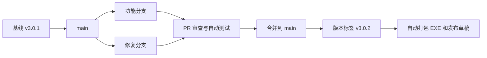

# PrototypeEditor 开发源码

原型编辑工具 3.0.1 的整理版源码。已拆分页面、样式和脚本，可继续修改功能并构建 Windows EXE。

## GitHub 协作

`main` 保留稳定版本；每个功能建立 `feature/*` 或 `fix/*` 分支，通过 Pull Request 合并。初始基线使用 `v3.0.1` 标签保存，后续发布使用新的版本标签。



提交分支会生成可下载的试用包；推送正式版本标签会生成单文件 EXE 并创建 Release 草稿。首次上传与仓库设置见 [GitHub 上手](docs/GitHub上手.md)，日常开发与发布见 [CONTRIBUTING.md](CONTRIBUTING.md)。

## 快速开始

测试环境为 Windows x64、Node.js 24.21.0。首次安装依赖、启动或打包时需要网络下载运行包。

```bash
npm ci
npm run check
npm start
```

开发版使用项目内的 `.dev-profile`，与正式版的本地配置分开。

## 修改哪里

| 目录或文件 | 内容 |
| --- | --- |
| `src/prototype/pages/` | 29 个页面，按页面 key 命名 |
| `src/prototype/styles/` | 原型公共和模块样式 |
| `src/prototype/shells/`、`top-nav.html` | 模块框架与公共导航 |
| `src/prototype/project.json` | 页面元数据及资源文件映射 |
| `src/editor.js` | 编辑器及通用组件和交互逻辑 |
| `src/io-alarm.js` | IO Alarm 专用交互 |
| `src/image-export.js`、`toolbar.js` | 图片导出和菜单逻辑 |
| `src/editor.template.html` | 编辑器界面模板 |
| `app/main.cjs`、`preload.cjs` | Electron 桌面程序和受限桥接 |
| `tests/` | 工程导入、桌面和 IO Alarm 检查 |

`app/index.html` 是自动生成文件。请修改 `src/`，不要直接修改它；启动、测试和打包前会自动重新生成。

## 把 EXE 中修改的原型重新打包

先在 EXE 中使用“文件 → 保存工程”，再将工程 JSON 放入源码目录：

```bash
npm run import-project -- ./my-project.json
npm run build
npm start
npm run dist
```

导入会替换内置原型源码，并先备份到 `.qa/backups/`。工具页面内的 Save 只是本地预览保存，不能代替“保存工程”。

## 检查和打包

```bash
npm test       # 运行自动化检查
npm run pack  # 生成完整应用目录
npm run dist  # 生成单文件便携 EXE
```

- 目录版：`dist/win-unpacked/PrototypeEditor.exe`，须保留整个目录。
- 便携版：`dist/PrototypeEditor-3.0.1-portable.exe`，文件名随版本变化。
- 修改版本号后，同时检查窗口标题和 preload 中的版本标识。
- 打包使用本项目安装的 Electron；首次便携打包可能还需下载构建工具。

## 说明

本包不含依赖目录、下载缓存或个人配置。构建后的初始页面与整理前 3.0.1 一致。测试基线以该版本为准，主动调整页面结构或默认值时，需要同步对应测试。

源码入口和常见问题见 [开发指南](docs/开发指南.md)。
